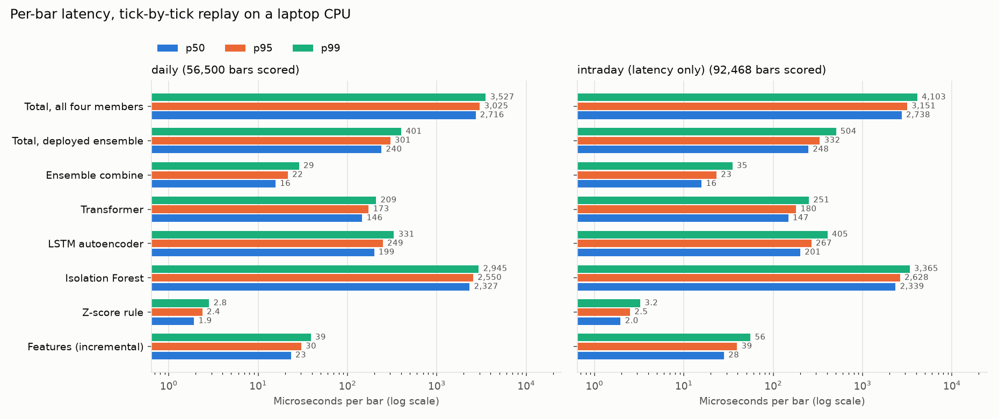
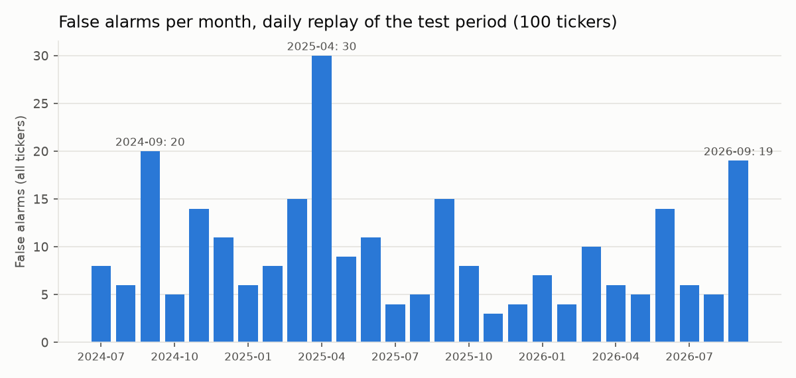

> Originally built Dec 2024–Jan 2025. The original code was lost, and this is a 2026 rebuild.

# realtime-financial-anomaly-detection

An end-to-end ML system that watches a large universe of stocks for anomalies in real time. It has a data pipeline, an ensemble of detection models (Isolation Forest, LSTM autoencoder, small Transformer), and a live-replay benchmark that measures detection latency and false-alarm rate.

**Status:** under construction. The environment is set up and the build phases are in [PLAN.md](PLAN.md). Results will appear here only after the code that produces them has actually been run, and every number will be backed by a file in `results/`.

## Setup

Requires Python 3.12 and runs on a laptop CPU. No GPU needed.

```bash
git clone https://github.com/mehwishahmed/realtime-financial-anomaly-detection.git
cd realtime-financial-anomaly-detection
python3.12 -m venv .venv
source .venv/bin/activate
pip install -r requirements.txt
pip install -e . --no-deps
```

The Makefile sets `PYTHONPATH=src`, so `make` commands work even if the editable install doesn't. (On macOS, files under an iCloud-synced Documents folder can be marked hidden, and Python 3.12 skips hidden `.pth` files.) To run a script by hand, use `PYTHONPATH=src python scripts/...`.

## Running the pipeline

All settings are in [`configs/default.yaml`](configs/default.yaml). Change `universe.file` and `universe.max_tickers` to scale from ~100 tickers up to the full S&P 500 or all US-listed stocks.

| Command | What it does |
|---|---|
| `make universe` | Refresh the ticker lists in `configs/tickers/` (S&P 500 from Wikipedia, all US-listed from NASDAQ Trader) |
| `make data` | Download daily and 5-minute bars from yfinance into a local parquet cache (batched, with retries) |
| `make features` | Clean the data, build features, assign time-based splits, and write data-quality reports to `results/data/` |
| `make labels` | Tag real events (earnings shocks, large moves), inject synthetic anomalies into val/test, write `results/labels/` |
| `make baselines` | Sanity-check the evaluator with a random scorer and a simple z-score rule, write `results/metrics/` |
| `make iforest` | Phase 3: grid-search Isolation Forest on validation, report on test, write `results/models/` and `results/metrics/` |
| `make deep` | Phase 4: train the LSTM autoencoder and Transformer forecaster on CPU, save training curves to `results/charts/`, evaluate |
| `make stream` | Phase 6: tick-by-tick replay. Daily test period: latency + detection. Intraday: **latency only** |
| `make results-table` | Regenerate the README results table from `results/metrics/summary.csv` |
| `make test` | Run the test suite |

## How results are measured

Every model goes through the same evaluator (`src/anomaly/evaluation/`). The alarm threshold is tuned on the **validation** period, and results are reported on the **test** period. There are two label tracks: *synthetic* anomalies injected at known times (price spikes, volume bursts, level shifts) and *real* events (earnings-day shocks, large single-day moves).

| Metric | Definition |
|---|---|
| Precision / recall / F1 | Per bar: is each flagged (ticker, day) inside a labeled anomaly? |
| PR-AUC | Area under the precision-recall curve. Random guessing scores about the anomaly rate (~1.5%), not 0.5 |
| Event recall | Share of anomaly events with at least one alarm between their start and 3 bars after their end |
| Detection delay | Bars from an event's start to its first alarm (0 = same bar) |
| **False alarms per day (all tickers)** | Total false alarms ÷ trading days, **summed across every ticker**. This is the alert volume someone watching the whole universe sees, so it grows with the number of tickers |
| **False alarms per ticker-day** | Total false alarms ÷ (tickers × trading days) |
| **False alarms per ticker per month** | False alarms per ticker-day × 21 trading days. Doesn't depend on universe size, so use it to compare runs with different ticker counts |

A false alarm is an alarm on a bar that isn't part of any event. Alarms in the 3 bars after an event (late detections) and alarms on the other track's events are never counted as false alarms.

## Results so far

100 randomly chosen S&P 500 stocks (seed 42), daily bars. The test period is 2024-07-01 to 2026-09-30. Every number below comes from [`results/metrics/summary.csv`](results/metrics/summary.csv), produced by `make baselines`, `make iforest`, `make deep`, and `make ensemble`. The table is generated from that file by `make results-table`. Thresholds were tuned on validation; the test set was not used to choose anything.

<!-- results-table:start (generated by scripts/results_table.py; do not edit by hand) -->
| Model | PR-AUC synthetic | PR-AUC real | Event recall synthetic | Event recall real | False alarms / day (all tickers) | False alarms / ticker / month |
|---|---|---|---|---|---|---|
| Random scores (sanity floor) | 0.016 | 0.008 | 0.892 | 0.815 | 34.58 | 7.263 |
| Z-score rule | 0.303 | 0.654 | 0.860 | 0.728 | 0.51 | 0.107 |
| Isolation Forest | 0.218 | 0.714 | 0.756 | 0.889 | 2.08 | 0.437 |
| LSTM autoencoder, original (bottleneck 32) | 0.229 | 0.184 | 0.771 | 0.409 | 1.22 | 0.257 |
| LSTM autoencoder, fixed (bottleneck 4) | 0.251 | 0.664 | 0.717 | 0.731 | 0.55 | 0.116 |
| Transformer forecaster | 0.235 | 0.721 | 0.775 | 0.865 | 0.94 | 0.198 |
| Ensemble, equal weights (untuned) | 0.254 | 0.720 | 0.775 | 0.856 | 0.89 | 0.187 |
| Ensemble, tuned on synthetic + real (val) | 0.302 | 0.790 | 0.857 | 0.863 | 0.70 | 0.146 |
| **Ensemble, tuned on synthetic (val)** | 0.320 | 0.735 | 0.863 | 0.760 | 0.46 | 0.096 |
<!-- results-table:end -->

**About the two LSTM rows.** The original LSTM autoencoder (bottleneck 32) partly *copied* large moves through its bottleneck: on validation it rebuilt ~78% of a big return at the bar it scores, which hid exactly the anomalies it should flag. A search over tighter bottlenecks (4, 8, 16), selected by **validation** PR-AUC only, picked 4 (403 parameters). Copying dropped to ~14%, and both rows are reported. The full search table is in [`results/models/lstm_autoencoder_bottleneck_search.csv`](results/models/lstm_autoencoder_bottleneck_search.csv); the original had slightly higher validation PR-AUC on synthetic anomalies (0.286 vs 0.277) but far lower on real events (0.217 vs 0.717). Training curves are in [`results/charts/`](results/charts/).

**About the ensembles.** Each member's scores are put on a common scale using statistics from its train-split scores, then averaged with weights searched on validation in steps of 0.1 ([`results/models/ensemble_search.csv`](results/models/ensemble_search.csv), chosen weights in [`results/models/ensembles.json`](results/models/ensembles.json)). The ensemble tuned on synthetic anomalies is 90% z-score rule and 10% LSTM autoencoder (robust z-scores). The one tuned on both label tracks is 60% rule, 30% Isolation Forest, and 10% LSTM (percentile ranks). Nearby weightings score within 0.01 on validation, so the robust finding is "mostly the rule, plus a small share of a learned model".

## Streaming simulation

`make stream` replays data **one bar at a time** through the same path a live system would use: raw prices go in, features are updated incrementally from small per-ticker buffers, the bar is scored by each ensemble member, the scores are combined, and an alarm fires if the score crosses the threshold tuned on validation. Every stage is timed per bar. Numbers come from [`results/streaming/`](results/streaming/). Hardware: a laptop CPU, single-threaded inference.

### Daily replay: latency and detection (the main result)
The test period (2024-07-01 to 2026-09-30: 565 trading days, 100 tickers, 56,500 bars), replayed bar by bar with the tuned ensemble (90% z-score rule + 10% LSTM autoencoder).

| Stage (per bar) | p50 (µs) | p95 (µs) | p99 (µs) |
|---|---|---|---|
| Incremental features | 23 | 30 | 39 |
| **Deployed ensemble, end to end** | **240** | **301** | **401** |
| All four members (incl. zero-weight ones) | 2,716 | 3,025 | 3,527 |

- **False alarms during the replay:** 258 in total, which is **0.46 per trading day across all tickers**, or **0.096 per ticker per month**. Monthly counts are in [`daily_alarms_by_month.csv`](results/streaming/daily_alarms_by_month.csv).
- **Detection during the replay:** event recall 0.863 (synthetic) / 0.760 (real), mean detection delay 0.06 / 0.00 bars after the event starts.
- **Streaming equals batch:** across 56,500 test bars, the largest difference between streamed and batch ensemble scores is 4.4e-05, with **0 alarm disagreements**. The streaming path can only see past bars, so this match also confirms the batch pipeline has no lookahead.
- **Bottleneck:** Isolation Forest costs ~2,327 µs per single-bar call (scikit-learn per-call overhead). It has zero weight in the deployed ensemble, so it isn't on the live path.




### Intraday replay: ⚠️ latency-only check
**This run measures speed only. It does not measure detection quality.** The models were trained on *daily* features, so their scores on 5-minute bars aren't meaningful anomaly detections, and no detection or false-alarm numbers are reported for it. It shows the same real-time path keeps up at 5-minute cadence: 92,664 bars (99 tickers, 12 trading days, 2026-10-01 to 2026-10-16), deployed ensemble **p50 248 µs, p95 332 µs, p99 504 µs** per bar. That's far below the 5-minute bar interval. Details are in [`intraday_latency_only.json`](results/streaming/intraday_latency_only.json).

## Project layout

| Path | What's there |
|---|---|
| `configs/` | YAML settings and ticker universe files |
| `src/anomaly/` | Library code: data, labels, evaluation, models, streaming |
| `scripts/` | One command-line entry point per pipeline step |
| `notebooks/` | Data exploration and results visualization |
| `tests/` | pytest suite |
| `results/` | CSVs and charts behind every reported number |

## License

MIT. See [LICENSE](LICENSE).
